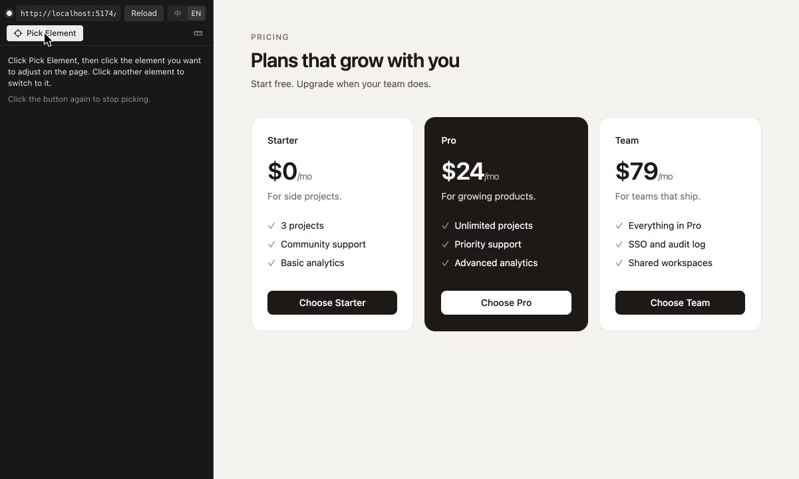

# Cursor CSS Tuner

A Cursor extension: pick elements in the built-in browser, tune their CSS, edit their text and their components' props, and reorder them among their siblings with live preview, hand the changes to Cursor's Agent to put in your source code, see them checked on the page, and revert any single change.



User guide: [English](packages/extension/README.md) · [简体中文](packages/extension/README.zh-CN.md). The rest of this document covers development and is written in Chinese.

---

Cursor 扩展：在内置浏览器里点选元素、可视化调 CSS、改文字和组件属性、在兄弟之间换序、实时预览，交给 Agent 写进源码、页面上自动核对，并可逐条还原。

使用说明、支持范围和限制见 [packages/extension/README.zh-CN.md](packages/extension/README.zh-CN.md)（英文版 [README.md](packages/extension/README.md) 是商店页）；这份文档讲开发。

## 仓库结构

| 目录 | 内容 |
| --- | --- |
| `packages/protocol` | 扩展、页面脚本、面板之间的消息类型和数值工具（颜色、单位换算、刻度） |
| `packages/engine` | 定位引擎：在源码里找到改动对应的位置，写进给 Agent 的提示词，自己不改文件。Tailwind 类名出现在哪（v4 用项目里 `@tailwindcss/node` 的设计系统；v3 由 `tailwind/v3.ts` 适配成同样的接口：用项目自己的 tailwindcss 读 tailwind.config、按候选类生成 CSS），主题刻度（`tailwind/scales.ts`），令牌对应的工具类顺带设置、预览时要一起设上的属性（如 `text-lg` 的行高，`tailwind/classes.ts`）；命中的 CSS 规则（`css/rules.ts`）、CSS Modules 类名映射；Vue / Svelte 单文件组件（`sfc.ts` 用项目自己的 `vue/compiler-sfc`、`svelte/compiler` 解析，样式块和脚本按原位置抠出来；`tailwind/template.ts` 把模板里的 `class`、`:class`、`class:` 转成和 JSX 一样的 `ClassSite`，`tailwind/sites.ts` 按文件类型分派）；`structure/` 里定位 JSX 文字和字符串 prop、翻译 JSON 里的键（jsonc-parser）、JSX 子节点和 `.map()` 用的数组字面量（`reorder.ts`）、组件调用处的属性和 `cva` / `tv` 配方的变体（`attr.ts`）。纯函数，单元测试最多 |
| `packages/bridge` | 注入到页面里的脚本：点选、高亮、样式快照（命中规则和胜出声明）、同源元素里哪些跟着一起变（`links.ts`：属性的值由同一处声明决定的才算写法相同，同一条规则、`style` 里同样的值、同一处继承来的声明；命中的规则和 `style` 都相同的元素层叠只算一次，同伴很多时有额度，花完了照旧全部一起变；`cascade.ts` 按最后一段选择器的类名、标签名给规则建索引，只试可能命中的）、文字分段、兄弟组识别（按 fiber 链分叉处分项，`.map()` 渲染的各项单独成组）、预览（样式、文字、用 `order` / 位移模拟的换序）、删属性后的值（`fallback.ts` 临时去掉生效的声明量出计算值；预览改过、删过的声明，快照照样按原样读）、双击编辑、覆盖层上的拖动把手、组件 props 的读取和预览（页面加载时装上 React DevTools 钩子，用 renderer 的 `overrideProps`，见 `devtools.ts`、`props.ts`）、交给 Agent 后的核对（`verify.ts` 的 `probe`：临时撤下预览，读出源码给出的值，对上了再撤掉预览；交出去之前记下同伴里哪些挂着预览（`peerBase`），核对时该变的都变了、别的没被带着变才算对上）、图片和视频的收集（`assets.ts`：挑 `srcset` 里最大的一张，序列化内联 SVG）、页面用 `@font-face` 加载的字体（`page.ts` 读 `document.fonts`）、标尺（`measure.ts`）、元素到源码的定位（`locator.ts` 定义每种框架的定位适配器，`source.ts` 按元素分派：React 读调试信息 + sourcemap（`react-source.ts`），Next.js 走开发服务器接口，React 18 的 `_debugSource` 按模块的 sourcemap 纠正 `@vitejs/plugin-react` 4 造成的行号偏移；Vue 把组件实例的渲染树和从开发服务器取回的模板按编译器的规则对齐（`vue-source.ts`、`vue-template.ts`）；Svelte 读开发态挂在元素上的 `__svelte_meta`（`svelte-source.ts`）；都不是时按纯 HTML 处理。Nuxt、SvelteKit 这类服务端渲染的页面等激活完再连回扩展） |
| `packages/panel` | 侧栏 webview 面板（React） |
| `packages/extension` | 扩展本体：内置浏览器适配、会话通道、定位计划（`planner.ts`；样式和文字：元素自己的 JSX、调用处的 prop、`t()` 对应的翻译文件、HTML；换序：JSX 父元素、数组字面量、HTML 父元素；属性：组件调用处。同源元素里只有一部分跟着变的属性（写法不同、类名写在条件分支或变体里、往命中好几个元素的规则里加声明），预览只带上那一部分，改动按那一组分开记，提示词写明只改哪几个）、属性的可选值（配方变体，或在调用处问 TS 语言服务的字面量补全，`completions.ts`）、改动清单（`journal.ts`）、上一步 / 下一步（`history.ts` 每一步记下相关未应用改动的前后快照，交给 Agent 的改动不在里面）、交给 Agent（`prompt.ts` 写应用和还原两种提示词，`handoff.ts` 预填进新的 Agent 对话、不发送，`applier.ts` 交出去时存下文件快照，盯着文件变化和页面更新核对）、图片和视频的下载（`assets.ts`）、本机字体列表（`fonts.ts`：macOS 用 JXA 调 `NSFontManager`，Windows 用 PowerShell，Linux 用 `fc-list`；第一次打开字体菜单时读，缓存一分钟）、自检 |
| `fixtures/` | 端到端测试用的小项目：`tw-react`（Vite + Tailwind 4，带 react-i18next）、`tw3-react`（Vite + Tailwind 3.4，主题在 `tailwind.config.ts`）、`react-css`（Vite + 普通 CSS / CSS Modules）、`next16`（Next.js 16 App Router，带 next-intl；`dev` 是 Turbopack，`dev:webpack` 是 webpack）、`vue3`（Vite + Vue 3 + Tailwind 4，带 scoped 样式、插槽、透传类名的组件）、`svelte5`（Vite + Svelte 5 + Tailwind 4，带组件样式、snippet、`class:` 指令）、`nuxt`（Nuxt 4）和 `sveltekit`（SvelteKit 3）两个冒烟用的最小项目、`static-html`；`demo` 是录商店页素材用的英文演示页 |
| `docs/media/` | 商店页和 README 用的动图、截图（README 里用 raw.githubusercontent 的绝对地址引用） |
| `spike/` | Phase 0 的可行性验证脚本（不参与构建） |

一次调参的数据流：扩展用 Cursor 内置浏览器的 CDP 命令把 `bridge` 注入页面 → 页面经带 token 的 WebSocket 连回扩展 → 选中元素时页面上报样式快照、各属性和哪些同源元素写法相同、文字分段、兄弟组、所属组件收到的 props 和源码位置 → 扩展为每个属性、每段文字、兄弟组和组件属性找代码位置（Tailwind 类名（JSX 或 Vue / Svelte 模板）/ CSS 规则（含 Vue / Svelte 的样式块）/ 变量定义 / JSX 文字 / 调用处的 prop / 翻译 JSON / HTML / JSX 子节点顺序 / 数组字面量 / 调用处的属性；找不到时记下原因）→ 拖动和输入时页面只做预览（同一处代码渲染出的元素里，写法相同的跟着变）→ 应用时把改动写成提示词预填进新的 Agent 对话，存下相关文件的快照，预览留着 → Agent 改了工作区里的文件、页面热更新后（改翻译文件时 Vite 会整页刷新，Next 的 webpack 模式改 CSS Module 也会，页面重新连上后再核对），页面脚本临时撤下预览，读出源码给出的计算样式、文字、兄弟的顺序（按各项文字的字符计数指纹认，和它里面的顺序无关）和组件收到的 props，和预览对上就标为已应用、撤掉预览 → 还原同样交给 Agent，对比看交出去时的快照和现在的文件。

## 开发

需要 Node 22、pnpm 11（`corepack enable` 后按 `packageManager` 自动取版本）和最新版 Cursor。

```bash
pnpm install
pnpm build       # bridge → panel → extension
pnpm typecheck
pnpm test
pnpm package     # 产出 packages/extension/dist/cursor-css-tuner.vsix
```

在 Cursor 里调试扩展：先 `pnpm build`，再用开发模式打开一个 fixture 窗口：

```bash
cursor --extensionDevelopmentPath="$PWD/packages/extension" --new-window "$PWD/fixtures/tw-react"
```

fixture 的开发服务器各自启动（`pnpm --filter fixture-tw-react dev`、`pnpm --filter fixture-next16 dev` 等）。next16 的 webpack 模式用 `pnpm --filter fixture-next16 dev:webpack`，输出目录是 `.next-webpack`，能和 Turbopack 的开发服务器同时跑（换个端口）。改了 `bridge` 或 `panel` 之后要重新 `pnpm build`，扩展构建时会把它们复制进 `packages/extension/media/`。

面板可以脱离 Cursor 在浏览器里调：`pnpm --filter @css-tuner/panel dev`，页面里用模拟宿主驱动。

## 端到端自测

CI 跑不了内置浏览器，端到端测试在本机的 Cursor 里跑：扩展以开发模式启动时，如果 `packages/extension/selftest.json` 存在，就按里面的步骤执行，把结果写到 `out` 指定的文件，跑完可选关闭窗口。正式安装的扩展不会读这个文件，打包时也会排除它。

```json
{
  "out": "/tmp/css-tuner-e2e.json",
  "closeWindow": true,
  "steps": [
    { "do": "backup", "files": ["/abs/path/fixtures/tw-react/src/App.tsx"] },
    { "do": "open", "url": "http://127.0.0.1:5411/" },
    { "do": "select", "selector": "[data-testid=header]", "props": ["padding-left"] },
    { "do": "edit", "props": ["padding-left", "padding-right"], "value": "2rem", "token": "8", "phase": "commit" },
    { "do": "apply" },
    { "do": "touchFile", "file": "/abs/path/fixtures/tw-react/src/App.tsx", "find": "px-6 py-4", "replace": "px-8 py-4" },
    { "do": "settle" },
    { "do": "revert", "index": 0 },
    { "do": "touchFile", "file": "/abs/path/fixtures/tw-react/src/App.tsx", "find": "px-8 py-4", "replace": "px-6 py-4" },
    { "do": "settle" },
    { "do": "compareFiles", "restore": true }
  ]
}
```

`apply` 和 `revert` 只整理提示词、开始核对，不打开 Agent 对话，也不碰剪贴板（`indexes` / `index` 是改动清单里的序号，0 是最新的）；`touchFile` 按 `find` / `replace` 改一下文件，模拟 Agent 照提示词改代码；`settle` 等到没有改动还在等 Agent（或到 `timeoutMs`），返回清单。要看提示词但不改状态用 `prompt`；预填本身用 `prefillProbe` 拿一段无害的文字测，不会发送。

常用步骤：`open`、`serveStatic`、`select`、`hover`、`edit`（`remove: true` 时删属性）、`send`（直接发一条面板消息，比如 `undo`、`redo`、`editMany`、`resetProps`）、`texts`（列出选中元素的文字分段和代码位置）、`editText`（在面板里改一段文字）、`pageEdit`（在页面上双击文字输入，`key` 是 `Enter` 或 `Escape`）、`order`（列出选中元素所在兄弟组和代码位置，`read` 给了时按显示位置读出这组元素的文字）、`reorder`（在面板里把第 `item` 项挪到第 `to` 个）、`pageDrag`（在页面上拖选中元素的把手，放到 `over` 那个元素的前半或后半）、`props`（列出选中元素所属组件的属性、可选值和代码位置，`waitOptions` 指定的属性等到 TS 补全给出选项再返回）、`editProp`（在面板里改一个属性）、`completions`（直接问语言服务某处的补全，排查选项用）、`debugPlan`、`apply`、`revert`、`touchFile`、`settle`、`prompt`、`discard`、`diff`、`fileLine` / `fileRange`、`backup` / `compareFiles`（`restore: true` 时把备份写回去）、`pick`（自由选择：开关、合成悬停、点击、离开页面、按键，读出页面上画了哪些框）、`measure`（标尺：开关、合成一次悬停读出数字、点击、按键）、`assets` / `saveAsset` / `saveAllAssets` / `assetText`（图片和视频的清单、另存为、全部下载、SVG 代码，不弹对话框）、`fonts`（打开字体菜单，等本机字体读完，返回页面字体、本机字体的个数、`has` 里的字体装没装和主题字体）、`viewport`（`scale` 设像素密度）、`exec`（在页面里执行脚本）、`execFallback`（模拟 CSP 拦住 WebSocket：`keep: true` 停在 exec 模式，`end: true` 恢复）、`config`（只改工作区级设置，不碰用户设置）、`locale`（切换界面语言，和面板上的“中 / EN”走同一条路，但不写进用户设置）、`dumpState`（导出面板状态）、`screenshot`、`command`（执行编辑器命令）、`selfCheck`、`state`。完整列表见 `packages/extension/src/selftest.ts`。

自测窗口里的内置浏览器标签不在前台时，`requestAnimationFrame` 可能一帧都不跑：靠它驱动的入场动画（比如 GSAP 的滚动入场）会停在 `opacity: 0`，元素看不见、也不能双击编辑。在真实项目上测双击前，先用 `exec` 把要测的元素设成可见。

在别人的项目上跑之前先 `backup` 所有可能被写的文件，结尾用 `compareFiles` 确认字节级一致。

## 商店页素材

`docs/media/` 里的动图和截图用真实的页面和真实的面板状态逐帧合成，演示页是 `fixtures/demo`（`pnpm --filter fixture-demo dev`）：

1. **面板状态**：在开发宿主里跑自测，每一步之后用 `dumpState` 把面板状态导出到 `packages/panel/public/`（这里的 `*.json` 不进仓库）。状态里有扩展按当前语言写的说明（比如交给 Agent 的原因），中英文各跑一遍，开头用 `locale` 步骤切换语言。
2. **面板帧**：启动面板调试页，打开 `shots.html?lang=en&spec=/shots.json`。spec 把各帧按网格排开渲染，`drag` 模拟按住数值字段拖动，`point` 指定指针落点；渲染完后 `window.__shots` 给出每帧的位置、指针坐标和字段的值。格式见 `packages/panel/src/shots.tsx`。`prefs` 是各分区的折叠状态，要带上 `v: 1`，否则面板会把改动清单折叠起来；一份 spec 里的帧共用同一套折叠状态，改动清单展开的帧（比如总览图）另写一份 spec。
3. **页面帧**：在 Cursor 内置浏览器里打开演示页，用 `<script>` 加载 `packages/extension/media/bridge.js`，`__cssTunerBridge.boot(...)` 之后通过 `window.__CSS_TUNER__.call('select' | 'hover' | 'preview', ...)` 驱动选中、悬停和预览；应用之后的帧直接改源码，等热更新。
4. **合成**：写一份分镜 JSON（每帧的面板裁切位置、页面截图、指针和停留时间），运行 `node scripts/media/compose.mjs <分镜文件>` 输出动图和静态截图。

截图用 CDP 的 `Page.captureScreenshot`。两个坑：模拟的视口不能比标签页的实际尺寸大，否则超出的部分是错乱的画面；窗口被别的窗口完全挡住时浏览器不出新帧，截图会一直等（`screenshot` 步骤默认 5 秒超时）。

## 依赖的内部接口

这几处都不是公开 API，变化时只需要改对应的适配代码：

- **Cursor 内置浏览器命令**（`workbench.action.openBrowserEditor`、`cursor.browserView.*`）：集中在 `packages/extension/src/browser.ts`；启动时 `selfcheck.ts` 会检查命令是否还在。
- **Next.js 开发服务器的 `/__nextjs_original-stack-frames`**（错误浮层用的栈帧解析接口）：请求和 URL 换算在 `packages/bridge/src/react-source.ts` 和 `packages/bridge/src/next.ts`；接口不可用时退回直接读 sourcemap。webpack 模式的栈帧是 `webpack-internal:///…`，原样交给这个接口解析；它的 CSS 没有 sourcemap，靠 webpack 在模块前面留下的 `!*** css …!./src/app/globals.css ***!` 注释认出源文件（`webpackCssSources`）。
- **Tailwind 3 的内部模块**（`tailwindcss/lib/lib/setupContextUtils` 的 `createContext`、`tailwindcss/lib/lib/generateRules`）：v3 适配器用它们同步地为候选类生成规则，集中在 `packages/engine/src/tailwind/v3.ts`。
- **React DevTools 全局钩子**（`__REACT_DEVTOOLS_GLOBAL_HOOK__`，renderer 注册时带上的 `overrideProps`）：props 预览用，集中在 `packages/bridge/src/devtools.ts`。钩子要在 React 加载前装上，所以扩展打开页面时先在空白页登记文档开始时执行的脚本，再导航过去；拿不到 `overrideProps` 时面板提示刷新页面。
- **Vue 开发态挂在 DOM 上的 `__vnode`**（vnode 的 `ctx`、组件的 `type.__file`、编译器给 v-if 分支注入的 key、开发态根片段的 patchFlag）：集中在 `packages/bridge/src/vue-source.ts`；模板原文用 Vite 的 `/@fs/…?raw` 从开发服务器取。
- **Svelte 开发态的 `__svelte_meta`**（元素的 `loc` 和一层层的 `parent`）：集中在 `packages/bridge/src/svelte-source.ts`。
- **激活信号**：Nuxt 挂载完在 `#__nuxt` 上放 `__vue_app__`，SvelteKit 开发态激活前一刻删掉内联的 `<style data-sveltekit>`；`packages/bridge/src/source.ts` 的 `whenHydrated` 据此等页面激活完再打招呼。

## 发布

1. 改 `packages/extension/package.json` 的 `version`，在 `packages/extension/CHANGELOG.md` 里写更新内容。
2. 推送同名标签（如 `v0.1.0`），`Release` 工作流会检查、测试、打包，发布到 Open VSX，并把 VSIX 附到 GitHub Release。
3. 首次发布前，在 [open-vsx.org](https://open-vsx.org) 用 GitHub 登录，然后：
   - 在个人资料页关联 Eclipse 账号并签署发布者协议。
   - 在 Namespaces 页创建与 `publisher` 同名的命名空间。
   - 在 Access Tokens 页生成令牌（选这个命名空间、勾选 Publishing only），存为仓库密钥 `OVSX_PAT`。Publishing only 的令牌不能创建命名空间，所以命名空间要先建好。

## 许可

[MIT](LICENSE)
