# Cursor CSS Tuner 安装与使用教程

在 Cursor 内置浏览器里点选页面上的元素，像用设计工具一样改间距、圆角、文字和字体，确认后交给 Cursor 的 Agent 写进源码。全程不用自己找代码、改类名。

截图里用的是仓库自带的演示项目 `fixtures/demo`（一个价格页），换成你自己的项目操作完全一样。

**开始前确认两件事：**

- Cursor 是最新版。
- 你的网页项目能在本地跑起来（React、Vue、Svelte，样式用 Tailwind 3 / 4 或普通 CSS 都可以）。只有一个 HTML 文件也行，见文末常见问题。

---

## 一、安装（1 分钟）

### 1. 在扩展商店搜索并安装

点侧栏顶部的「扩展」图标（快捷键 macOS `⇧⌘X`，Windows `Ctrl+Shift+X`），在搜索框粘贴下面这行，结果只会有一个：

```
@id:WYCM9527.cursor-css-tuner
```

认准发布者是 **WYCM9527**，点「安装」。

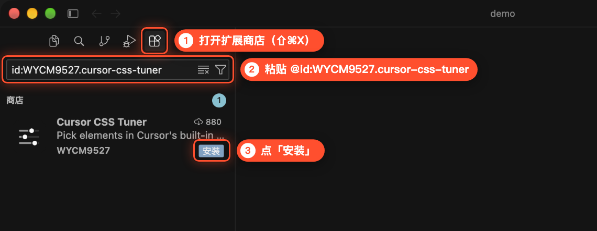

> 直接搜 “CSS Tuner” 也能搜到，但它排在好几个同类扩展后面，容易装错，建议用上面的 ID 搜。输入框窄的时候开头的 `@` 会被挤出去看不见，这是正常的。

### 2. （可选）在详情页确认

点搜索结果可以打开详情页，确认发布者和版本后点「安装」也一样。

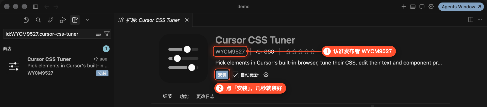

装好后，侧栏顶部会多出一个**滑块图标**，后面就从它打开插件面板。

---

## 二、把你的页面打开

### 3. 启动项目

在 Cursor 里打开你的项目文件夹，菜单「终端 → 新建终端」，输入项目的启动命令（大多数项目是 `npm run dev`）。等终端出现 `Local:` 那一行，**记下后面的地址**。

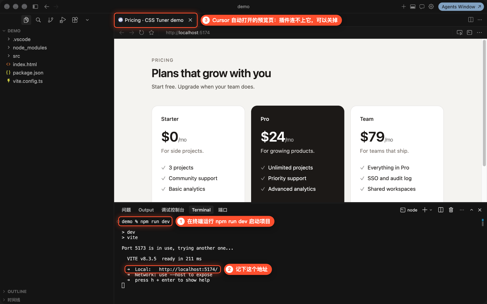

- 端口被占用时会自动换一个，比如图里 5173 被占了，就换成了 5174。以终端里显示的地址为准。
- Cursor 可能会自动打开一个预览标签页（图中 ③）。插件连不上这个标签页，可以直接关掉，下一步要用插件面板重新打开。

### 4. 打开 CSS Tuner 面板，填地址

点侧栏顶部的滑块图标，打开「调参」面板。把刚才记下的地址填进输入框，点「打开」。

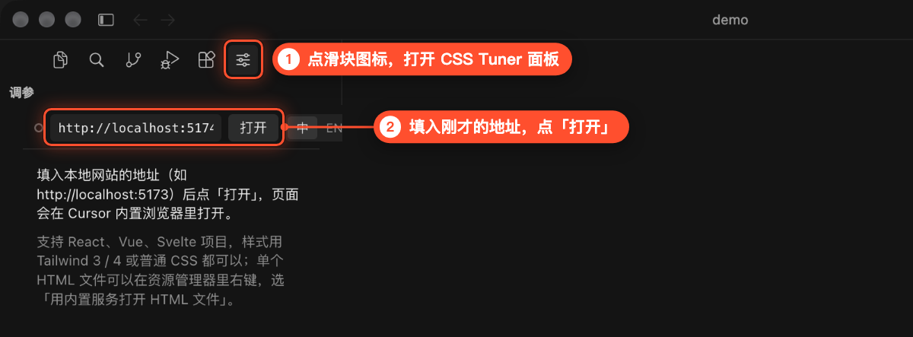

### 5. 确认已连接

页面会在 Cursor 内置浏览器的新标签页里打开。面板左上角的**圆点变成实心**，「打开」按钮变成「刷新」，就说明插件连上了。

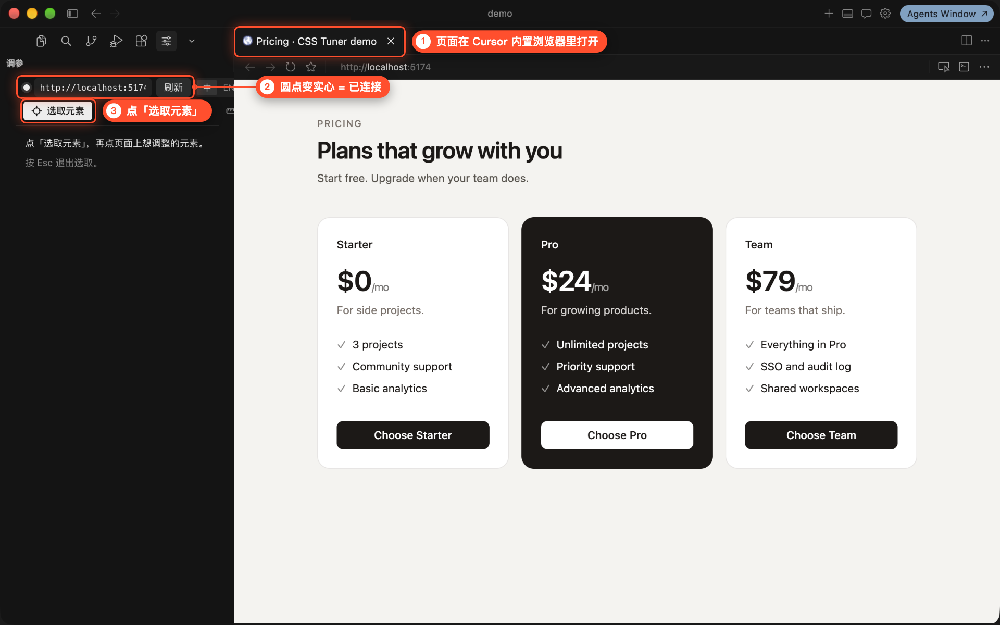

---

## 三、选中要改的元素

### 6. 点「选取元素」，在页面上找目标

点面板里的「选取元素」，然后把鼠标移到页面上。鼠标下的元素会出现**虚线框**，旁边标出它的名字和尺寸。选取会一直开着，按钮变成「退出选取」，再点一次才退出；开着时点页面不会触发页面自己的按钮和链接。

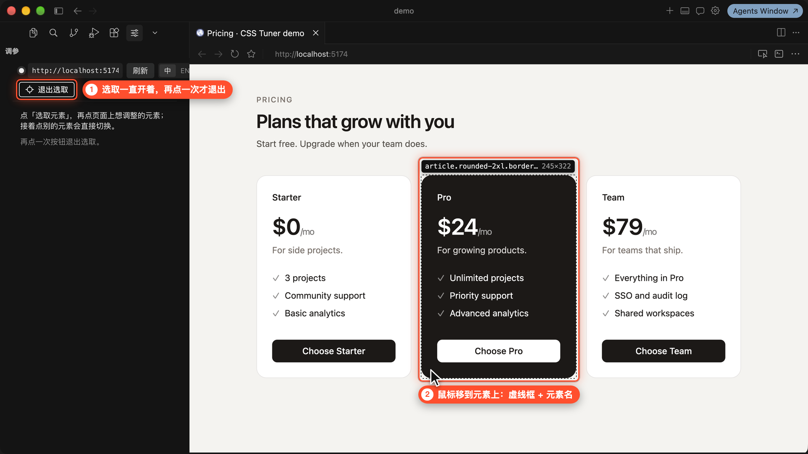

### 7. 点一下选中

点击后框会收起，免得挡住效果；把鼠标移开再移回这个元素，会出现实线框和它的文件行号。接着点别的元素，面板直接切过去。面板里会显示：

- **源码位置**（图中 ①）：这个元素写在哪个文件的哪一行，图里是 `src/Plan.tsx` 第 14 行。
- **可以调的属性**：间距（图中 ②）、圆角（图中 ③），还有布局、尺寸、文字、填充、描边、投影等。数值后面的小字是 Tailwind 刻度，比如内边距 `24` 对应刻度 `6`。

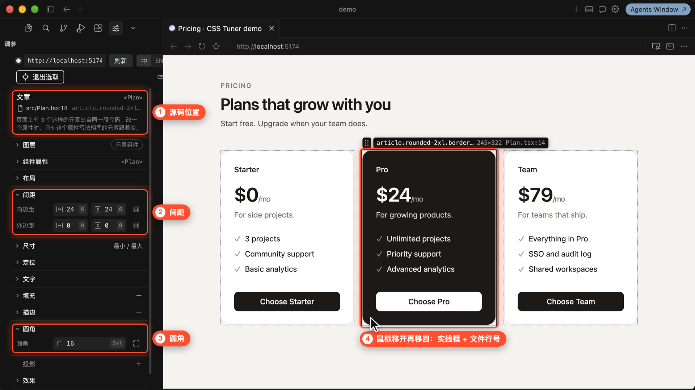

> 为了截图清楚，图里把暂时用不到的分组收起来了。点分组标题就能展开或收起。

---

## 四、改样式、文字和字体

### 8. 改数值，页面实时变化

直接在数值上输入新值，或者按住拖动。图里把卡片的内边距从 `6` 改成了 `8`（24px → 32px），圆角也从 `2xl` 改成了 `3xl`。

页面会**马上变化**，但这时只是预览，源码还没动。每一处修改都会记在面板顶部的「改动」清单里。

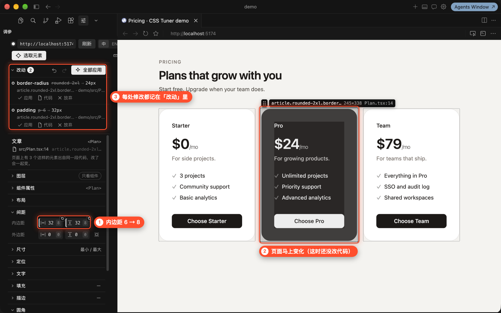

- 「改动」清单默认收成一行，点一下展开就能看到每一条。
- 想撤销，点「全部应用」左边的上一步 / 下一步，或在面板里按 `⌘Z` / `⇧⌘Z`（Windows 是 `Ctrl+Z` / `Ctrl+Shift+Z`）。

> 页面上的三张卡片是同一段代码渲染出来的，内边距和圆角三张写的是同一处，所以改一张、三张一起变。写法不一样的各改各的：中间那张的深色底写在另一个分支里，改两边卡片的底色时它不动。

### 9. 改文字

先用「选取元素」选中文字所在的元素（图里选的是标题），再**双击页面上的文字**直接改，也可以在面板的「内容」里改。按回车确认，按 `Esc` 取消。

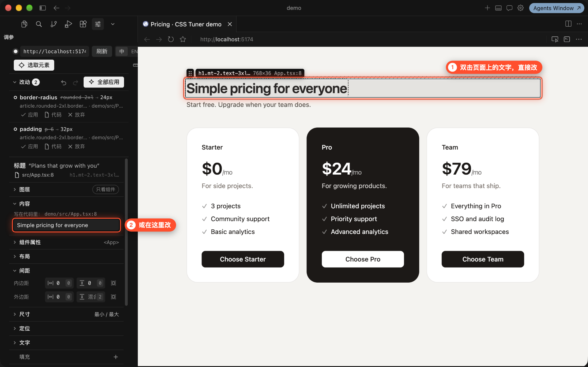

### 10. 换字体

在「文字」分组里点「字体」，会弹出字体菜单，按来源分组：

- **主题字体**：项目主题里定义的字体，比如 Tailwind 的 `sans`、`serif`、`mono`。普通 CSS 项目这一组叫「CSS 变量」，列的是像字体的变量。
- **页面字体**：页面用 `@font-face` 加载的字体。演示项目没有加载字体，所以图里没有这一组。
- **本机字体**：你电脑上装的字体，每个都用它自己的字形显示。
- **通用字体**：`serif`、`sans-serif`、`monospace` 这类，由浏览器挑一款系统里对应的字体。

鼠标停在哪个字体上，页面就先换成它预览，点一下才算改。顶部可以搜索，也可以直接输入字体名。按 `Esc` 或点别处关掉菜单，会恢复原来的字体。

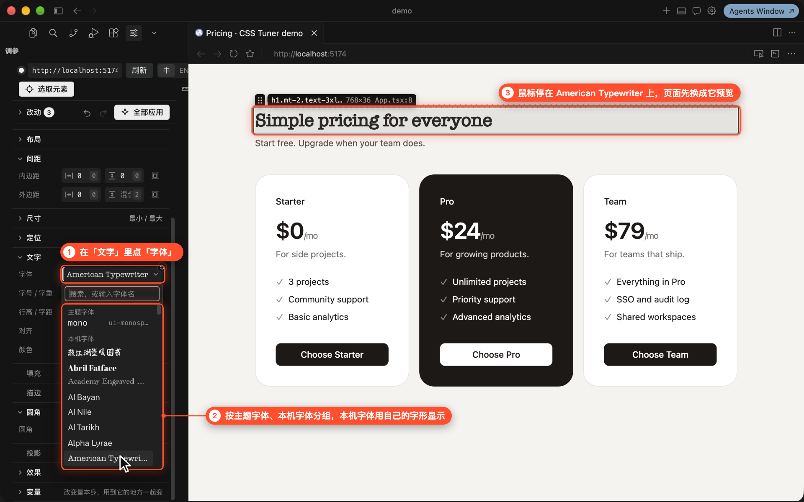

> 本机字体只装在你的电脑上，页面并没有加载它，别人打开页面时不一定有。选了这类字体，插件会在交给 Agent 的提示词里注明。

---

## 五、交给 Agent 写进代码

### 11. 点「全部应用」

效果满意后，点「改动」右边的「全部应用」。只想要其中一条的话，点那一条下面的「应用」；不要的点「放弃」。

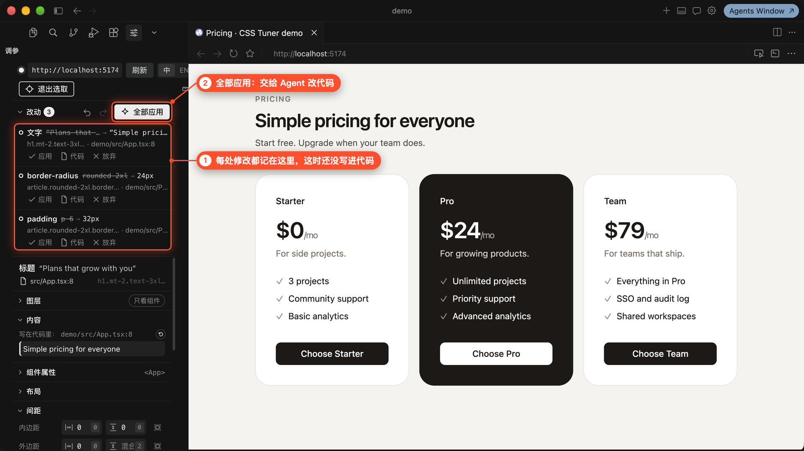

### 12. 在 Agent 对话里按回车

插件会把改动整理成一段提示词，放进一个新的 Agent 对话，同时复制到剪贴板。提示词里写清了每处改动在哪个文件、哪一行，改前改后是什么。检查一下，**按回车发送**，Agent 就会去改代码。

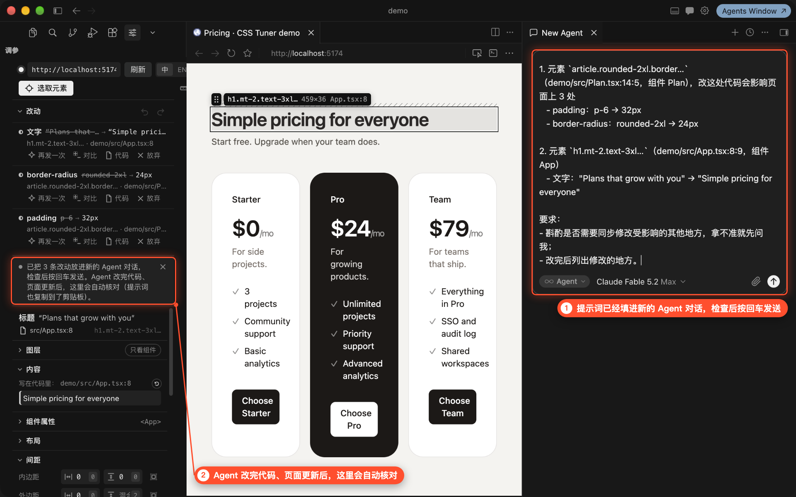

> 插件只填好提示词，不会替你发送。没看到新对话的话，自己新建一个 Agent 对话，粘贴剪贴板里的提示词再发送。

### 13. 自动核对，标成「已应用」

Agent 改完代码、页面热更新后，插件会自动核对页面上的样式和文字，对得上的标成「已应用」，圆点变成实心。每一条都可以单独「还原」，也可以点「对比」看代码改了哪里。

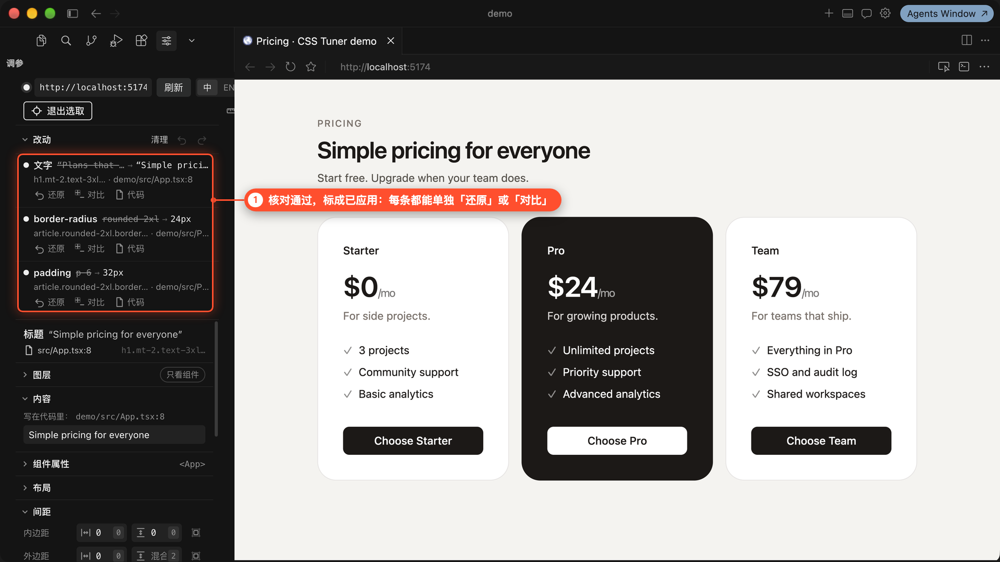

> 还在等 Agent 的改动，下面有「再发一次」：上一次没发出去，或者 Agent 没改对，点它重新放进新的对话。

### 14. 「对比」看代码改了哪里

点「对比」会打开左右对比的视图：左边是交给 Agent 之前的文件，右边是现在。

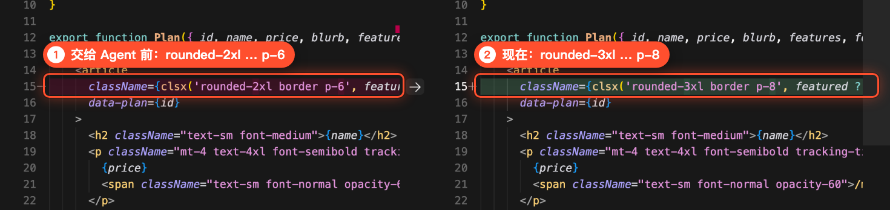

完成。以后改样式的流程就是：**选取元素 → 改 → 全部应用 → 在 Agent 对话里按回车**。

---

## 常见问题

**圆点一直是空心，或者点了页面没反应？**

- 页面一定要用面板里的「打开」打开，自己打开的浏览器标签页连不上。
- 地址要和终端里显示的一致，开发服务器要保持运行。
- 点「刷新」再试一次。还不行就按 `⇧⌘P`（Windows `Ctrl+Shift+P`），运行「CSS Tuner: 自检」，它会列出每一项检查的结果。

**选中后提示“没有找到源码位置”？**

页面需要跑在开发模式下（`npm run dev` 这类命令），打包后的线上版本找不到源码位置。

**找不到滑块图标？**

侧栏顶部图标多的时候，它可能被收进了最右边的「⌄」里。也可以按 `⇧⌘P` 运行「CSS Tuner: 打开页面」。

**只有一个 HTML 文件，没有开发服务器？**

在左侧文件列表里右键这个 HTML 文件，选「CSS Tuner: 用内置服务打开 HTML 文件」。

**改错了怎么办？**

还没应用的，用上一步或「放弃」；已经应用的，在清单里点那一条的「还原」，插件同样会把提示词放进新的 Agent 对话，按回车后由 Agent 改回去。

**按了回车，Agent 也改完了，还是没标成「已应用」？**

插件要等页面热更新后才核对，开发服务器要保持运行。代码改了、页面上的值却对不上时，那一条下面会写出页面上现在的值，可以点「再发一次」让 Agent 重改，或点「对比」看它改了什么。

**面板想换成英文？**

点面板顶部的「中 / EN」切换。
