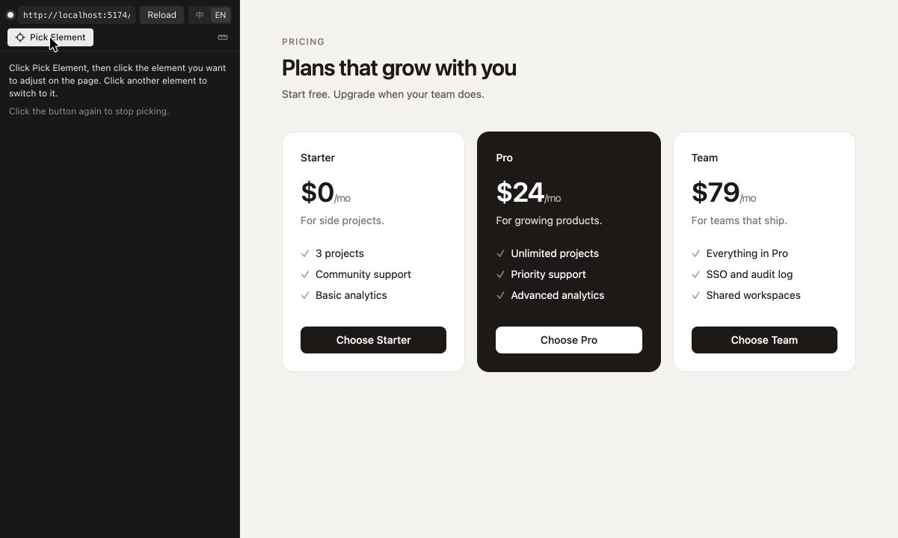
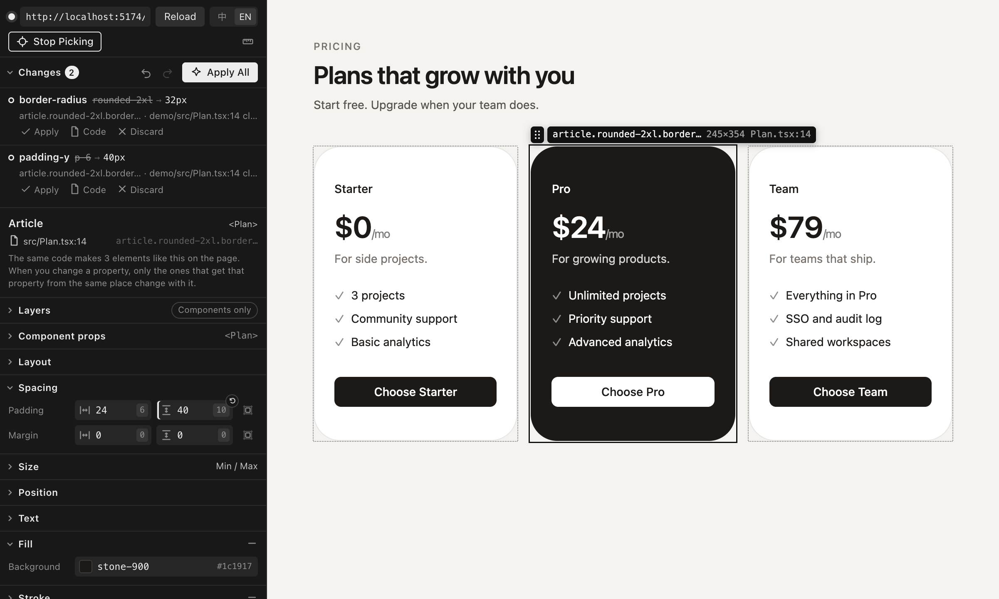

# Cursor CSS Tuner

Pick an element in Cursor's built-in browser, drag its values, edit its text, change its component's props or move it among its siblings and watch the page update, then hand the change to the Agent to put in your source code and see it checked on the page. Every change can be reverted on its own.

English · [简体中文](https://github.com/WYCM9527/Cursor-CSS-Tuner/blob/main/packages/extension/README.zh-CN.md)

It does one job: **adjust styles, text, order and props inside Cursor, see the result, and put it in your code**. When you click Apply, the extension drafts a prompt and prefills a new Agent chat; you review it and press Enter to send. The extension doesn't edit your files itself. Once the Agent has made the change and the page has updated, the panel checks the page against the preview.

## Features

- **Pick elements**: hover to highlight, click to select. The panel says what you picked in plain words, followed by the start of its text (for example *Heading “Welcome”*), and which file it's written in. The Layers section shows the elements around it, and every instance rendered by the same line of JSX or template is marked on the page.
- **Tuning panel**: layout (flex / grid), spacing, size, position, text, fill, stroke, radius, shadow, effects and CSS variables. Drag or scrub numbers, pick colors, and snap to your theme's values and CSS variables; hold Alt for any value. Fill and stroke can also be a linear or radial gradient: set the angle, click the gradient bar to add a color stop, drag stops to move them, and pick each stop's color from your theme.
- **Add and remove properties**: an element with no fill, stroke or shadow gets one from the + on that section, and − takes it away again. Every value that comes from a declaration in your code has a × in its corner: the page drops it right away, and applying asks the Agent to remove the declaration (in Tailwind, its class), so the element falls back to what it would be without it. Inherited values, initial values and framework presets have nothing to remove.
- **Undo, redo and reset**: the change list sits at the top of the panel, folded into one line by default (click it to see each change). Undo and Redo, right next to Apply All (or ⌘Z / ⇧⌘Z, Ctrl+Z / Ctrl+Shift+Z, in the panel), step through the changes you haven't applied yet, and a field with an unapplied change shows a reset button in its corner. The change list follows along.
- **Edit text**: the Content section lists the selected element's text, split into runs around inline tags such as `<b>`. Edit a run there, or double-click text inside the selected element on the page and type in place. Enter adds the change to the list; Esc undoes it.
- **Reorder siblings**: drag the handle next to the selected element's tag on the page, drag its row in Layers, or use the move buttons below it. The page previews the new order with CSS `order` (flex and grid) or transforms instead of moving DOM nodes, so the change is marked “preview only” until you apply it.
- **Edit component props**: the Component props section lists the props that the component rendering the selected element receives at its call site. Strings, numbers and booleans can be edited. Variants of a `cva` / `tailwind-variants` recipe and string literal union types (from TypeScript) are offered as options, including variants the call site doesn't set. The page shows the new value right away through React's DevTools hook, and every instance created by the same call site changes together. Server components are read-only on the page and change once the Agent has edited the code.
- **Images & video**: the Images & video section (after Variables, folded by default) lists the images, background images, SVGs and videos you can see in the selected element. Save one with *Save As…*, save them all into a folder with *Download All* (duplicate names get a number), copy an SVG's code, or find the file in your project. Images with a `srcset` are saved at their largest size. Saved SVG files use the colors shown on the page, while the copied code keeps `currentColor`. Streaming videos (MediaSource, HLS, DASH) have no complete file to download, but their poster can be saved.
- **Ruler**: turn on the ruler in the panel's toolbar and hover an element on the page to measure its distance from the selected element, with the spacing scale's name next to each number. Click to select the hovered element, and press Esc to leave. With the ruler off, hold Alt while hovering after you select an element.
- **Viewport**: view the page at phone (390px), tablet or desktop width; the tablet and desktop widths come from your theme's `md` and `lg` breakpoints. A page that doesn't fit is scaled down. The width stays when the page reloads or changes, and goes back when the panel is folded or closed. With a width picked, style changes only apply to that range of widths, and the prompt says which range. The preview also only shows at those widths, and the check switches the page to them.
- **Live preview**: changes only touch the page, not your code. After you hand them to the Agent, the preview stays until the page matches it.
- **The Agent changes the code**: click Apply All, or Apply on one change, and the extension drafts a prompt and prefills a new Agent chat (it's copied to the clipboard too). Review it and press Enter; nothing is sent automatically. Each element gets one item saying where it is and what it should become (several changes to the same element share an item), without prescribing how to write it. The prompt ends with just two requests: consider whether other affected places should change too, asking you when unsure, and list what was changed. Matching theme tokens and CSS variables are included (for example `2rem (Tailwind token 8)`). Where the extension can pin it down, the prompt also gives the place in your code:
  - Tailwind classes (Tailwind 4, or Tailwind 3 with the theme from `tailwind.config`): string and template literals in JSX, `clsx` / `cn` / `twMerge` arguments, `cva` base classes and variants, class-name constants, and the `className` passed in at a component's call site. In Vue and Svelte components: the `class` attribute, `:class` strings, arrays and object literals, `class:` directives, and the `class` written where the component is used.
  - Plain CSS: the matching rule and its file. Nesting with `&`, `@import`ed files and CSS Modules are supported (hashed class names map back to the class in your source), as well as Vue `<style scoped>` and Svelte `<style>` blocks.
  - CSS variables: the definition (`:root`, Tailwind's `@theme`), so everything that uses the variable changes together.
  - Text: the text in the JSX; when a component renders text it receives as a prop, the string at the call site (`<Card title="…">` or its children); for messages from `t('key')` (react-i18next, next-intl), the JSON file of the language shown on the page, picked from the route (`/zh/…`) and then `<html lang>`; in plain HTML, the text in the HTML file. Text produced by code comes with the code that produces it.
  - Order: siblings written out in JSX, a list rendered with `.map()` over a constant array literal (in the same file, or imported through relative paths), or child elements in plain HTML. The prompt lists the siblings in their new order.
  - Props: the component's call site. When the call site also spreads props (`{...rest}`), the panel warns that the spread may override the value.

  When the extension can't pin a change down (for example classes built from variables, props passed as expressions such as `size={size}`, or lists that come from props or an API), the Agent looks for it, and the prompt passes on what the extension found out. For an element with no source location at all, the prompt gives its place in the page's element tree.
- **Checked automatically**: once the Agent has edited a file and the page has hot reloaded, the panel briefly lifts the preview, reads the computed styles, text, order and props your code produces, and marks the change *Applied* when they match the preview, which is then removed. Changes for one range of widths are checked at those widths. If the page shows something else, the change says what it shows now, and *Send Again* adds that to the prompt. When the Agent's edit makes the dev server reload the whole page (a message file in Vite, a CSS Module in Next.js webpack mode), the check runs again once the page reconnects.
- **Revert one change at a time**: click *Revert* on an applied change to put a prompt into a new Agent chat that asks it to change those places back; the change is marked *Reverted* once the page matches again. *Compare* opens your file from when the change was handed off next to the file now. A change that's still waiting can be dropped with *Discard* (which also removes its preview) or *Don't Revert*.
- **This one or all** (Tailwind): *This one* changes only the element you picked (when the component merges classes with `cn` / `twMerge`, the prompt points to where the component is used). *All* points to the component itself and its variants, so every place that uses it changes. The choice only appears when the two would change different places in your code, and *All* says how many elements on the page it affects.
- **English and Simplified Chinese**: the panel, notifications and Agent prompts follow Cursor's display language. Switch with 中 / EN at the top of the panel; the choice is saved in the `cssTuner.language` setting.

## Supported projects

| Stack | Status |
| --- | --- |
| React 18 / 19 + Vite, Tailwind 4 | Tested |
| React + Vite, Tailwind 3 (theme from `tailwind.config`) | Tested with 3.4 |
| React + Vite, plain CSS / CSS Modules | Tested |
| Next.js 16 App Router, `next dev` (Turbopack) and `next dev --webpack`, server and client components | Tested |
| react-i18next, next-intl with JSON message files | Text editing, tested |
| Component props | Client components in React 18 / 19 and Next.js, tested; server components aren't previewed and change once the Agent has edited them |
| Vue 3 + Vite, Nuxt 4 (`nuxt dev`) | Styles located in classes and `<style>` blocks, tested |
| Svelte 5 + Vite, SvelteKit 3 (`vite dev`) | Styles located in classes and `<style>` blocks, tested |
| Plain HTML + CSS (opened with the built-in static server) | CSS rules, text and order located |

The page must run in development mode: locating an element's source relies on React's development build, the location data Vue and Svelte attach to elements in development, and the dev server's source maps.

## Install

Search for **Cursor CSS Tuner** in Cursor's Extensions view and install it. You can also download the `.vsix` from [GitHub Releases](https://github.com/WYCM9527/Cursor-CSS-Tuner/releases) and choose "Install from VSIX…" from the menu at the top right of the Extensions view. Requires a recent version of Cursor.

## Quick start

1. Start your project's dev server (for example `npm run dev`).
2. Click the CSS Tuner icon in the activity bar, enter the page address in the Tuner panel and open it. The page opens in a tab of Cursor's built-in browser. You don't need to change your project or install anything.
3. Click **Pick Element**, then click an element on the page.
4. Drag the values in the panel; the page updates as you go, and each change appears in the list at the top of the panel, where Undo and Redo step back and forth through them. To change text, edit it in the Content section or double-click it on the page. To move an element among its siblings, drag the handle next to its tag on the page or its row in Layers. To change the props of its component, use the Component props section.
5. Click **Apply All** (or **Apply** on one change). The prompt goes into a new Agent chat; review it and press Enter. Once the Agent has changed the code and the page has updated, the change in the list turns **Applied**. Afterwards, **Revert** or **Compare** any single change.

For plain HTML projects, right-click an HTML file or folder in the Explorer and choose "CSS Tuner: Open HTML File with Built-in Server".

## Commands

| Command | What it does |
| --- | --- |
| CSS Tuner: Open Page | Opens a dev server page in the built-in browser and injects the tuner script |
| CSS Tuner: Pick Element | Turns element picking on the page on or off |
| CSS Tuner: Ruler: Measure Distances | Turns the ruler on or off, measuring between the hovered and the selected element |
| CSS Tuner: Apply All Changes | Drafts a prompt for every change in the list that isn't applied yet and prefills it in a new Agent chat |
| CSS Tuner: Open HTML File with Built-in Server | Serves HTML that has no dev server from a local static server |
| CSS Tuner: Self-Check | Runs injection, connection, selection, preview and re-injection after reload in a separate tab |

## Settings

| Setting | Default | Description |
| --- | --- | --- |
| `cssTuner.language` | `auto` | Language of the panel and its messages: `auto` follows Cursor's display language, or set `zh-CN` / `en`. The 中 / EN switch at the top of the panel changes this setting |
| `cssTuner.defaultUrl` | `http://localhost:5173/` | Address to open by default |
| `cssTuner.remBase` | `16` | Root font size used to convert between rem and px |
| `cssTuner.snap` | `true` | Snap numbers to the theme's values and CSS variables (hold Alt for any value) |
| `cssTuner.tailwind.scope` | `instance` | Whether Tailwind changes apply to just the element you picked (`instance`, “This one” in the panel) or to the component itself (`source`, “All”) |

## Limitations

- **Cursor only**: the extension injects its script through internal commands of Cursor's built-in browser (`cursor.browserView.*`). They are not a public API and may change when Cursor updates. The extension checks for them at startup and tells you if any are missing; you can also run "CSS Tuner: Self-Check" at any time.
- **Reordering stays within one parent**: it doesn't add or remove elements or move them to another parent. For lists built from props, state, API data, `filter()` / `sort()` results or `let` variables, the extension can't find the order in your source, so the prompt only gives the new order and the Agent decides how to change it.
- **The order preview is simulated**: flex and grid use `order`; other layouts shift elements with transforms, so with floats, absolute positioning or wrapping inline content the preview can differ slightly from the result.
- **Text is edited as plain text on one line**: line breaks become spaces, and inline tags such as `<b>` stay where they are, so each run around them is edited on its own. Only the message file of the current language changes; other languages are left as they are. For text produced by code (expressions, template strings, custom translation helpers, `t.rich`) and messages with placeholders, the extension can't pin down the exact spot, so the prompt includes the code that produces it.
- **Props**: only props written at the call site are listed, plus `cva` / `tailwind-variants` variants that the component passes to its own recipe (under the same name, as the whole props object, or through a spread). Objects, functions and elements are shown read-only. The preview hooks into React as the page loads, so a page that was already open before the tuner connected needs one reload; the panel offers a button for it. Options from TypeScript come from the TypeScript language service, which can take a few seconds to start in a large project.
- **Vue and Svelte: only styles are located**: changes to text, order and props come without a place in the code, and the Agent looks for it. Templates must be HTML (Pug isn't supported), and only plain-CSS `<style>` blocks are recognized; `lang="scss"`, `less` and `stylus` blocks can't be located. Elements rendered by components from `node_modules`, or by Vue components without a template (render functions, JSX), map to the tag where your code uses the component. In Vue only the component's root element maps, since that is where `class` falls through (not with `inheritAttrs: false`); in Svelte a class written there takes effect only if the component applies its `class` prop. Only Vite dev servers are supported; Nuxt and SvelteKit use one.
- **Next.js source locations** come from `/__nextjs_original-stack-frames`, an internal dev server endpoint used by the error overlay, which is not a public API either. Both Turbopack (`next dev`) and webpack (`next dev --webpack`) dev modes are tested. Hot reload of server components can take a few seconds, and the check waits for it. In webpack mode, editing a CSS Module can make Next.js reload the whole page.
- **Hot reload edge cases**: an element rendered before a hot reload and selected for the first time after it may point to an old line number. If a location looks wrong, reload the page.
- **CSS Modules** class names are matched by the longest source class name contained in the hashed name, so projects with a custom `generateScopedName` may not map correctly.
- **Tailwind 3 and 4 only**: the design system is loaded from your project's own `node_modules` to snap values and name tokens. In Tailwind 3 projects the theme is read from the `tailwind.config.*` named by `@config`, or the nearest one up to the project root. The Agent decides how to write values that are off the theme scale. Tailwind 3's `prefix` option isn't supported.
- **Gradient strokes are previewed with two background layers** (`background-clip: padding-box, border-box`), so rounded corners stay. When the element has no opaque fill, the prompt asks the Agent for another way that keeps the corners and leaves the inside transparent. Gradient strokes are always solid. Conic gradients, images and multi-layer backgrounds are shown in the panel but can't be edited there; switching to a solid color or a gradient replaces them.
- **Undo and Redo only cover changes you haven't applied**: changes handed to the Agent aren't in the history. To take one back, click *Revert* in the list.
- **The check relies on the page updating**: after a change is handed off, the panel waits until the page matches the preview. If the Agent didn't change anything, changed a place the page doesn't use, or the dev server didn't hot reload, the change stays *Waiting for the Agent*; use *Send Again* or *Discard*.
- **Viewport**: resizing the browser view while a width is picked doesn't rescale the page; switch to *Actual width* and back.

## Security and privacy

- The tuner script is injected only into tabs you open in Cursor's built-in browser. No proxy is involved and your project code isn't modified.
- The WebSocket between the page and the extension listens on `127.0.0.1` only and requires a random token.
- The extension makes no internet requests; in Next.js projects it only talks to your own dev server.

## Troubleshooting

- Logs are in the **CSS Tuner** channel of the Output panel.
- Run "CSS Tuner: Self-Check" to see the result of each check.
- If the page's CSP blocks the WebSocket, the extension switches to an `executeJavaScript` channel automatically. Everything still works, just a little slower.
- If the panel shows "No source location found" for a selected element, make sure the page is served by the dev server in development mode (for React, with React's development build).

## License

MIT. This is a community project and is not affiliated with Cursor (Anysphere).
