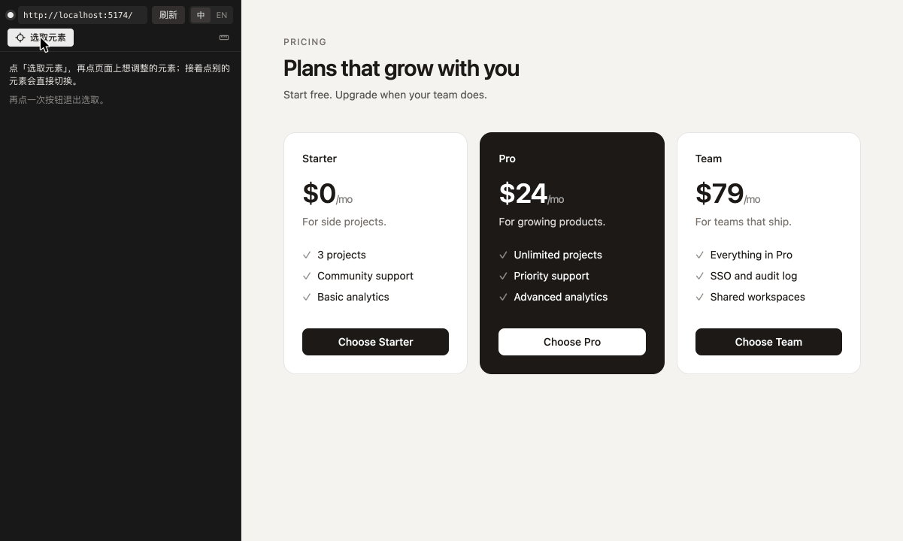
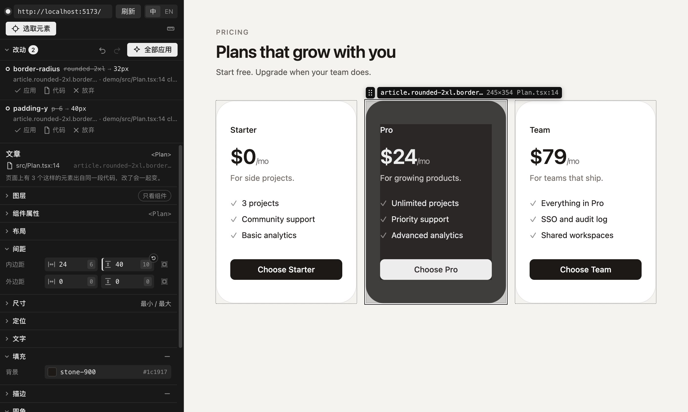

# Cursor CSS Tuner

在 Cursor 内置浏览器里点选元素，拖动数值、改文字、改组件的属性或在兄弟之间换位置，实时看效果，满意了交给 Agent 写进源码，页面上自动核对，每一条都能单独还原。

[English](https://github.com/WYCM9527/Cursor-CSS-Tuner/blob/main/packages/extension/README.md) · 简体中文

它要解决的事只有一件：**在 Cursor 里调样式、改文字、调顺序、改属性、看效果，再把效果应用到代码里**。点“应用”时，扩展把改动整理成提示词，预填进新的 Agent 对话，由你按回车发送；扩展自己不改代码文件。Agent 改完、页面更新后，面板核对页面和预览是否一致。

## 能做什么

- **点选元素**：在内置浏览器的页面上悬停高亮、点击选中。面板用大白话说出选中的是什么，后面跟着它的文字开头（比如“标题 “欢迎””），并标出写在哪个文件；“图层”分区列出它周围的元素，同一处 JSX 或模板渲染出的所有实例会在页面上标出来。
- **调参面板**：布局（flex / grid）、间距、尺寸、定位、文字、填充、描边、圆角、投影、效果、CSS 变量。数值可拖动、可滑动，颜色有取色器；默认对齐到主题里的值和 CSS 变量，按住 Alt 可以调任意值。填充和描边还可以用线性或径向渐变：改角度，点渐变条加颜色点，拖动颜色点改位置，每个颜色点都能选主题里的颜色。
- **增删属性**：没有填充、描边或投影的元素，点对应分区上的 + 直接加上，点 − 去掉。来自源码声明的值右上角都有 ×，点了页面上先去掉它，应用时请 Agent 删掉这条声明（Tailwind 里是对应的类名），元素回到没有它时的样子；继承来的值、初始值和框架预设样式没有可删的。
- **撤销、重做和重置**：改动清单在面板顶部，默认收成一行（点一下展开看每一条）。“全部应用”左边的上一步 / 下一步（在面板里也可以按 ⌘Z / ⇧⌘Z，或 Ctrl+Z / Ctrl+Shift+Z）在还没应用的改动之间前进后退；有未应用改动的参数，右上角会出现重置按钮。改动清单随时同步。
- **改文字**：面板的“内容”分区列出选中元素里的文字，遇到 `<b>` 这类行内标签会分成几段。可以在面板里改某一段，也可以在页面上双击选中元素里的文字直接输入；回车加进改动清单，Esc 撤销。
- **兄弟换序**：在页面上拖选中元素标签旁边的把手，或在“图层”里拖它那一行，或点下面的上移 / 下移按钮。页面上的新顺序用 CSS `order`（flex 和 grid）或位移摆出来，不移动真实的 DOM 节点，所以应用前这条改动会标成“仅预览”。
- **改组件属性**：面板的“组件属性”分区列出渲染选中元素的那个组件在调用处收到的属性。字符串、数字、布尔值可以改；`cva` / `tailwind-variants` 配方的变体和字符串字面量联合类型（来自 TypeScript）会列成选项，调用处没写的变体也会列出来。页面通过 React 的 DevTools 钩子立刻显示新值，同一个调用处创建的实例一起变。服务端组件在页面上只读，Agent 改完代码后生效。
- **图片和视频**：面板的“图片和视频”分区（在“变量”后面，默认收起）列出选中元素里看得见的图片、背景图、SVG 和视频。可以单个“另存为…”，“全部下载”存进选好的文件夹（重名自动加序号），复制 SVG 代码，或在项目里找到这个文件。带 `srcset` 的图片下载最大的那张；存下来的 SVG 文件把颜色换成页面上显示的颜色，复制的代码保留 `currentColor`。边加载边播放的视频（MediaSource、HLS、DASH）没有完整文件可下载，封面图可以单独下载。
- **标尺**：点面板工具栏上的标尺，在页面上悬停元素，量它和选中元素之间的距离，数字旁边标着间距刻度名；点一下改选中它，按 Esc 退出。不开标尺时，选中元素后在页面上按住 Alt 悬停也能量。
- **视口**：按手机（390px）、平板、桌面的宽度看页面，平板和桌面的宽度取主题里的 `md`、`lg` 断点；页面放不下时整页缩小显示。刷新和换页面后保持，面板收起或关掉时还原。选了一档时，改样式只改这一档的宽度范围，提示词会写明是哪个宽度范围；预览也只在这一档显示，核对时切到这一档的宽度。
- **实时预览**：改动先只作用在页面上，不碰源码；交给 Agent 之后预览也一直留着，直到页面对上为止。
- **交给 Agent 改代码**：点“全部应用”或某一条的“应用”，扩展把改动整理成提示词，预填进新的 Agent 对话（也复制到剪贴板），由你检查后按回车发送，不会自动发送。每个元素一项，写明在哪、要改成什么样（同一个元素的几处改动合在一项里），不规定具体写法；最后只提两点要求：斟酌受影响的其他地方要不要一起改、拿不准先问你，改完列出改了哪里。用得上的主题令牌和 CSS 变量会一起给出（如 `2rem（Tailwind 令牌 8）`）。扩展能定位到的，还会写上代码位置：
  - Tailwind 类名（Tailwind 4；Tailwind 3 的主题来自 `tailwind.config`）：JSX 里的字符串和模板字符串、`clsx` / `cn` / `twMerge` 参数、`cva` 的基础类和变体、类名常量、组件调用处传进去的 `className`；Vue 和 Svelte 组件里是 `class` 属性、`:class` 的字符串 / 数组 / 对象字面量、`class:` 指令，以及使用组件处写的 `class`。
  - 普通 CSS：命中的那条规则和它所在的文件；支持嵌套 `&`、`@import` 进来的文件和 CSS Modules（带哈希的类名会映射回源码里的类名），以及 Vue 的 `<style scoped>` 和 Svelte 的 `<style>` 样式块。
  - CSS 变量：定义处（`:root`、Tailwind 的 `@theme`），用到它的地方一起变。
  - 文字：JSX 里的文字；组件渲染的是传进来的 prop 时，是调用处的字符串（`<Card title="…">` 或子元素）；来自 `t('key')` 的文案（react-i18next、next-intl）是页面当前语言的 JSON 文件，语言先看地址里的语言段（`/zh/…`），再看 `<html lang>`；纯 HTML 是 HTML 文件里的文字。由代码生成的文字会带上生成它的代码。
  - 顺序：JSX 里写死的兄弟、用 `.map()` 渲染的常量数组（同一个文件里，或通过相对路径导入）、纯 HTML 里的子元素；提示词写明兄弟的新顺序。
  - 属性：组件的调用处。调用处还有展开写法（`{...rest}`）时，面板会提醒展开的值可能盖掉它。

  定位不到的（比如类名来自变量拼接，属性传的是 `size={size}` 这样的表达式，列表来自 props 或接口数据），由 Agent 自己找，提示词附上扩展知道的线索；连元素的源码位置都没有时，给出它的文字和在页面上的层级。
- **自动核对**：交出去之后，Agent 改了文件、页面热更新，面板就临时撤下预览，读出源码给出的计算样式、文字、顺序和属性，和预览一致就标成“已应用”，预览随之撤掉；只改某一档的改动切到那一档的宽度核对。对不上时，这条改动下面写明页面现在的样子，点“再发一次”，提示词会带上上一次的结果。Agent 改的文件让开发服务器整页刷新时（Vite 里改翻译文件、Next.js 的 webpack 模式里改 CSS Module），页面重新连上后再核对。
- **逐条还原**：已应用的改动点“还原”，同样把提示词放进新的 Agent 对话，请它把这几处改回原样，改回后标成“已还原”。“对比”打开交出去那一刻的文件和现在的文件。还在等的改动可以“放弃”（撤掉预览和这一条）或“不还原了”。
- **只改这个还是全部**（Tailwind）：“只改这个”只改选中的这一个元素（组件用 `cn` / `twMerge` 合并类名时，提示词指向用到组件的地方）；“全部”指向组件本身和它的变体，所有用到它的地方一起变。两种改法会改到代码里不同地方时才给这个选项，“全部”后面标着页面上会变几个元素。
- **中英双语**：面板、通知和交给 Agent 的提示词跟随 Cursor 的显示语言（简体中文或英文）；也可以点面板顶部的“中 / EN”切换，选择会记在 `cssTuner.language` 设置里。

## 支持的项目

| 技术栈 | 状态 |
| --- | --- |
| React 18 / 19 + Vite，Tailwind 4 | 已验证 |
| React + Vite，Tailwind 3（主题来自 `tailwind.config`） | 3.4 已验证 |
| React + Vite，普通 CSS / CSS Modules | 已验证 |
| Next.js 16 App Router，`next dev`（Turbopack）和 `next dev --webpack`，服务端组件和客户端组件 | 已验证 |
| react-i18next、next-intl，JSON 翻译文件 | 文字编辑已验证 |
| 组件属性 | React 18 / 19 和 Next.js 的客户端组件已验证；服务端组件不能预览，Agent 改完后生效 |
| Vue 3 + Vite，Nuxt 4（`nuxt dev`） | 样式定位到类名和样式块，已验证 |
| Svelte 5 + Vite，SvelteKit 3（`vite dev`） | 样式定位到类名和样式块，已验证 |
| 纯 HTML + CSS（用内置服务打开） | 定位 CSS 规则、文字和顺序 |

页面必须跑在开发模式下：元素到源码的定位依赖 React 开发构建的调试信息、Vue 和 Svelte 开发态挂在元素上的位置信息，以及开发服务器的 sourcemap。

## 安装

在 Cursor 的扩展面板搜索 **Cursor CSS Tuner** 安装；也可以从 [GitHub Releases](https://github.com/WYCM9527/Cursor-CSS-Tuner/releases) 下载 `.vsix`，在扩展面板右上角的菜单里选“从 VSIX 安装…”。需要最新版 Cursor。

## 快速开始

1. 启动项目的开发服务器（如 `npm run dev`）。
2. 点活动栏里的 CSS Tuner 图标，在“调参”面板里填页面地址并打开；页面会在 Cursor 内置浏览器的标签页里打开，不需要改项目代码、不需要装任何依赖。
3. 点“选取元素”，在页面上点一个元素。
4. 拖动面板里的数值，页面实时变化；改动会出现在面板顶部的清单里，上一步 / 下一步可以前进后退。要改文字，在“内容”分区里改，或者在页面上双击它。要在兄弟之间换位置，拖页面上元素标签旁边的把手，或拖“图层”里它那一行。要改它所属组件的属性，用“组件属性”分区。
5. 点“全部应用”（或某一条的“应用”），提示词会放进新的 Agent 对话，检查后按回车发送。Agent 改完代码、页面更新后，清单里这一条会变成“已应用”；之后可以对任意一条点“还原”或“对比”。

纯 HTML 项目：在资源管理器里右键 HTML 文件或文件夹，选“CSS Tuner: 用内置服务打开 HTML 文件”。

## 命令

| 命令 | 说明 |
| --- | --- |
| CSS Tuner: 打开页面 | 在内置浏览器里打开开发服务器的页面并注入调参脚本 |
| CSS Tuner: 选取元素 | 开关页面上的点选模式 |
| CSS Tuner: 标尺：量距离 | 开关标尺，量悬停元素和选中元素之间的距离 |
| CSS Tuner: 应用全部改动 | 把清单里所有未应用的改动整理成提示词，预填进新的 Agent 对话 |
| CSS Tuner: 用内置服务打开 HTML 文件 | 给没有开发服务器的 HTML 起一个本地静态服务 |
| CSS Tuner: 自检 | 在单独的标签页里实际跑一遍注入、连接、选中、预览和刷新后重新注入 |

## 设置

| 设置 | 默认值 | 说明 |
| --- | --- | --- |
| `cssTuner.language` | `auto` | 面板和提示用的语言：`auto` 跟随 Cursor 的显示语言，也可以设成 `zh-CN` / `en`。面板顶部的“中 / EN”改的就是这个设置 |
| `cssTuner.defaultUrl` | `http://localhost:5173/` | 默认打开的地址 |
| `cssTuner.remBase` | `16` | rem 和 px 换算用的根字号 |
| `cssTuner.snap` | `true` | 数值自动对齐到主题里的值和 CSS 变量（按住 Alt 可以填任意值） |
| `cssTuner.tailwind.scope` | `instance` | Tailwind 项目里默认只改选中的这一个（`instance`，面板上的“只改这个”），还是改组件本身（`source`，“全部”） |

## 限制

- **只支持 Cursor**：扩展通过 Cursor 内置浏览器的内部命令（`cursor.browserView.*`）注入脚本，这些不是公开 API，Cursor 更新后可能变化。扩展启动时会检查这些命令是否还在，缺失时会提示；也可以随时运行“CSS Tuner: 自检”。
- **换序只在同一个父元素里**：不会增加、删除元素，也不会把元素挪到别的父元素下。来自 props、state、接口数据、`filter()` / `sort()` 结果或 `let` 变量的列表，扩展找不到源码里的顺序，提示词只写新顺序，由 Agent 决定怎么改。
- **换序预览是模拟的**：flex 和 grid 用 `order`，其他布局用位移把元素挪过去；遇到浮动、绝对定位或折行的行内内容，预览和应用后的效果可能略有差别。
- **文字按单行纯文本改**：换行会变成空格；`<b>` 这类行内标签留在原位，它前后的文字各自单独改。只改当前语言的翻译文件，其他语言保持原样。由代码生成的文字（表达式、模板字符串、自己写的翻译函数、`t.rich`）和带占位符的翻译，扩展定位不到确切位置，提示词会带上生成它的代码。
- **属性**：只列出调用处写了的属性，另外加上组件传给自己配方的 `cva` / `tailwind-variants` 变体（同名传、整个 props 对象传或展开传）。对象、函数和元素只读。预览要在页面加载时接上 React，所以调参脚本连上之前就开着的页面需要刷新一次，面板上有按钮。TypeScript 给出的选项来自 TypeScript 语言服务，大项目里它启动要几秒。
- **Vue 和 Svelte 只定位样式**：文字、换序和属性的改动不带代码位置，由 Agent 自己找。模板必须是 HTML（不支持 Pug），只认普通 CSS 的 `<style>` 块，`lang="scss"`、`less`、`stylus` 的样式块定位不到。`node_modules` 里的组件、以及没有模板的 Vue 组件（渲染函数、JSX）渲染出的元素，定位到你的代码里使用这个组件的标签：Vue 只有组件的根元素能定位过去，因为 `class` 只透传到根元素（`inheritAttrs: false` 时也不透传）；Svelte 写在那里的类名要组件自己把 `class` 属性用上才生效。只支持 Vite 开发服务器，Nuxt 和 SvelteKit 用的就是它。
- **Next.js 的源码定位**借用开发服务器给错误浮层用的内部接口 `/__nextjs_original-stack-frames`，同样不是公开 API；Turbopack（`next dev`）和 webpack（`next dev --webpack`）两种开发模式都验证过。服务端组件的热更新可能要几秒，核对会等。webpack 模式下改 CSS Module 可能让 Next.js 整页刷新。
- **热更新的边界情况**：热更新之前就渲染出来、热更新之后才第一次选中的元素，可能定位到旧的行号；位置看起来不对时刷新一下页面。
- **CSS Modules** 的类名映射是按“哈希类名里包含的最长源码类名”匹配的，自定义了 `generateScopedName` 的项目可能对不上。
- **Tailwind 只支持 v3 和 v4**：设计系统从项目自己的 `node_modules` 加载，用来对齐刻度、给出令牌。Tailwind 3 项目的主题读 `@config` 指定的 `tailwind.config.*`，没写的话从入口往上找到项目根为止最近的那个。刻度外的值怎么写由 Agent 决定。不支持 Tailwind 3 的 `prefix` 选项。
- **渐变描边的预览用两层背景叠出来**（`background-clip: padding-box, border-box`），圆角保留；元素没有不透明的填充色时，提示词会请 Agent 换一种保留圆角、里面透明的写法。渐变描边只能是实线。圆锥渐变、图片和多层背景在面板里只显示、不能改，换成纯色或渐变会把它们替换掉。
- **上一步 / 下一步只管还没应用的改动**：已经交给 Agent 的改动不在历史里，要撤回，在清单里点“还原”。
- **核对靠页面更新**：交给 Agent 之后，面板一直等到页面和预览对上为止。Agent 没改、改到了页面没用到的地方，或开发服务器没有热更新时，这一条会停在“等 Agent 改”，可以“再发一次”或“放弃”。
- **视口**：模拟宽度时调整了浏览器视图的大小，缩放不会跟着重算，切到“实际宽度”再选回这一档即可。

## 安全与隐私

- 调参脚本只通过 Cursor 内置浏览器注入到你打开的标签页里，不走代理，也不改项目代码。
- 页面和扩展之间的 WebSocket 只监听 `127.0.0.1`，并要求随机 token。
- 扩展不访问外网；Next.js 项目只会请求你自己的开发服务器。

## 排查问题

- 日志在“输出”面板的 **CSS Tuner** 频道。
- 运行“CSS Tuner: 自检”，会列出每一项检查的结果。
- 页面的 CSP 拦住 WebSocket 时，扩展会自动改用 `executeJavaScript` 通道，功能不变，只是稍慢。
- 选中元素后面板显示“没有找到源码位置”：确认页面由开发服务器以开发模式提供（React 项目还要是 React 的开发构建）。

## 许可

MIT。这是社区项目，与 Cursor（Anysphere）官方无关。
